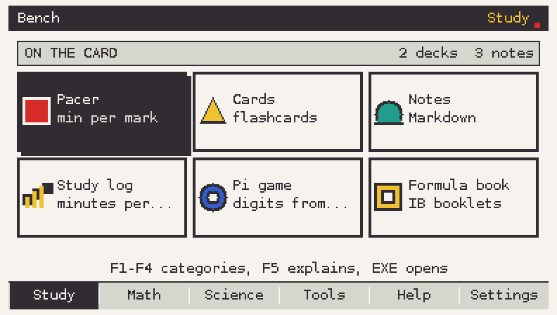
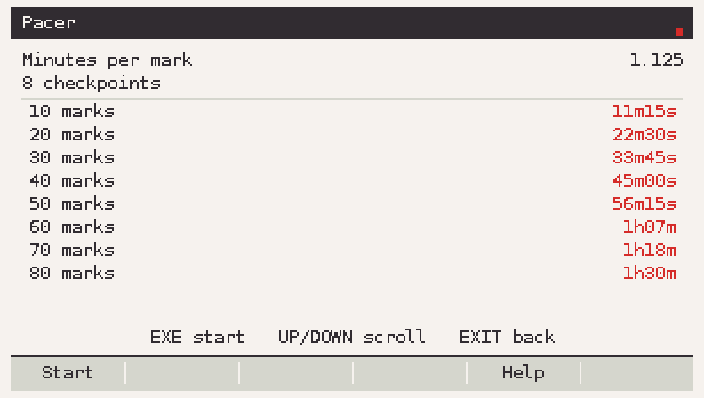
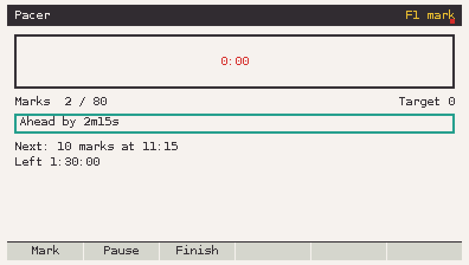
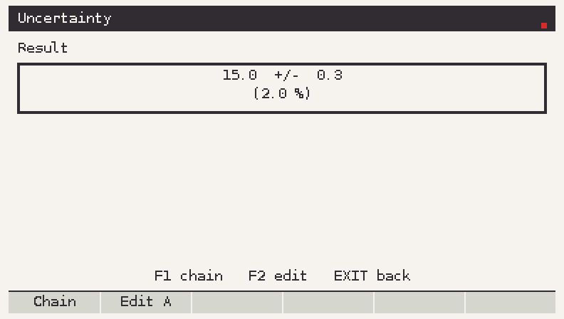
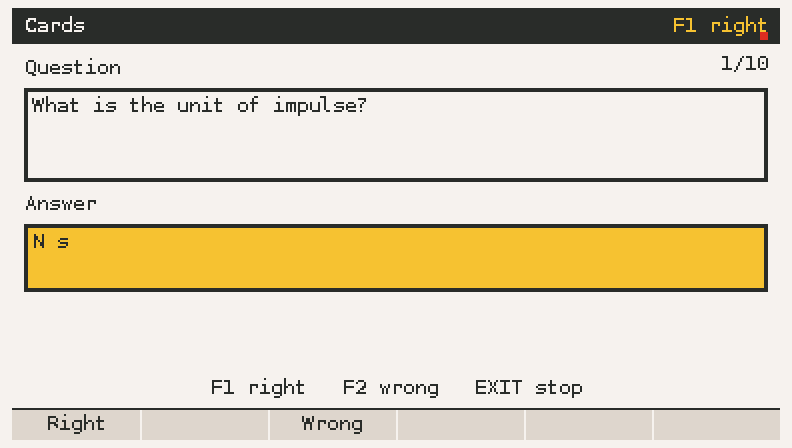
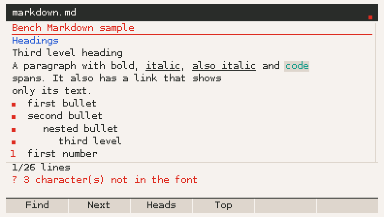
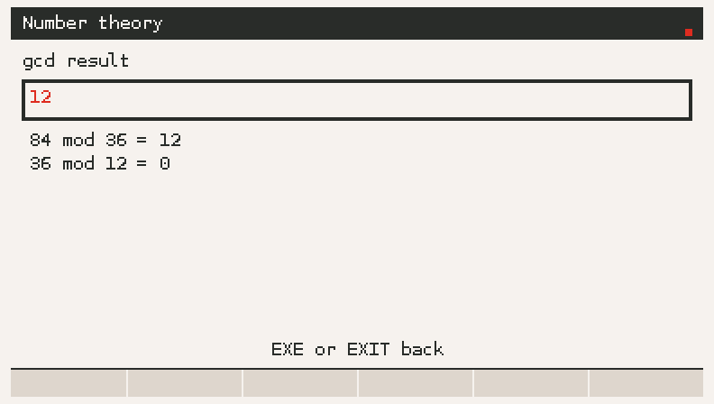
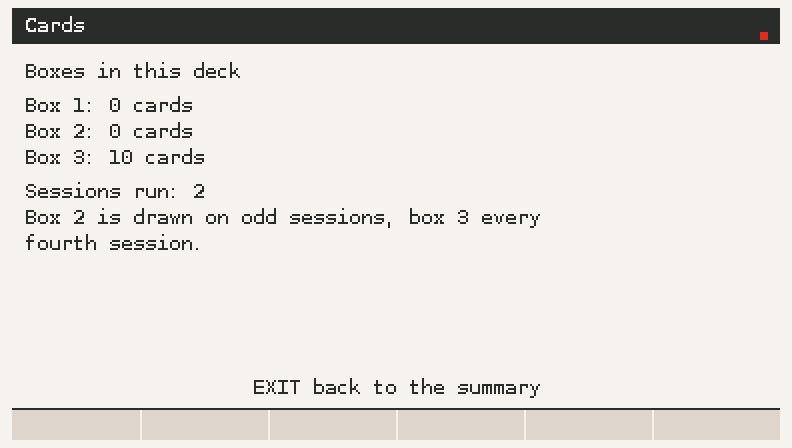
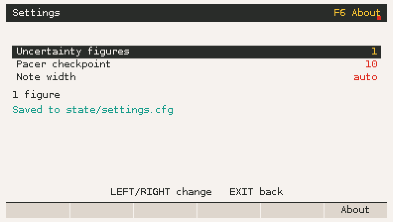

# Bench


**Five study tools in one add-in for the Casio fx-CG 50.** Pacer times a
practice paper, Uncertainty does error arithmetic, Cards drills flashcards with
a Leitner schedule, Notes reads text and Markdown, Number theory covers gcd to
CRT. One `.g3a`, one menu, no second add-in to install.

Bauhaus palette, neobrutalist edges: flat blocks of colour, heavy black
outlines, hard offset shadows, geometric shapes, no gradients and no animation.

```
Bench-1.0.0.g3a     <- copy this to the calculator's storage root
```

| | |
|---|---|
| Target | Casio fx-CG 50 (fx-CG 20 runs it too), OS 3.81 |
| Screen | 384x216 visible window, 396x224 framebuffer |
| Built with | fxSDK + gint 2.10, C11 |
| Version | 1.0.0 |
| Licence | MIT (see `LICENSE`) |

## Screens



| | |
|---|---|
|  |  |
|  |  |
|  |  |
|  |  |

Every picture in `docs/images/` is a real frame drawn by the add-in's own code,
rendered on a PC by `make sim` (see [Working on the code](#working-on-the-code)).
No mock-ups.

## The five tools

### Pacer
Minutes per mark, checkpoint times, and a live gap line: *"Behind by 1m20s"*.

- Setup: total minutes, total marks, marks per checkpoint.
- Enter 90 minutes and 80 marks, get 1.125 min/mark and eight checkpoints.
- Run: a clock, F1 to log a mark, F2 to pause, F3 to finish. The screen
  redraws four times a second, no faster.
- Done: total time and the final gap.

### Uncertainty
Combines measured values with their errors.

| Operation | Value | Uncertainty |
|---|---|---|
| A + B, A - B | a + b, a - b | da + db |
| A * B, A / B | a * b, a / b | \|r\| * (da/\|a\| + db/\|b\|) |
| A ^ n | a^n | \|r\| * \|n\| * da/\|a\| |
| k * A | k * a | \|k\| * da |

The result is shown as value, absolute uncertainty and percentage: `15.0 +/- 0.3`
with `(2.0 %)`. F1 chains the result into A for the next operation. Rounding
follows the setting: one figure for the uncertainty, or two when its first digit
is 1. Half-up on decimal digits, never on the binary float, so `0.15` rounds to
`0.2` the way a physics teacher expects.

### Cards
A Leitner drill over a plain text deck.

```
What is the unit of impulse? | N s
Ohm's law | V = I R
```

- One card per line, `question | answer`. Blank lines and `#` lines are skipped.
- 500 cards a deck, 120 characters a side; a line that cannot be used is
  reported with its line number and skipped.
- Three boxes: right moves a card up, wrong returns it to box 1. Box 1 is drawn
  every session, box 2 every other session, box 3 every fourth.
- Progress is keyed by a hash of the *question*, so editing an answer keeps the
  box and editing a question resets it.
- Saved once, when a session ends.

### Notes
A viewer for text and a Markdown subset, with search.

- Files from `Bench/notes`, `.md` and `.txt`, up to 32 KiB each.
- Markdown: `#` to `###`, **bold**, *italic*, `code`, fenced code, bullets,
  numbered lists, quotes, rules, links as text, `- [ ]` / `- [x]` checkboxes.
  Anything else is shown as plain text. Style is colour and underline (Phase A),
  so no extra fonts are needed.
- Scroll by line or page, F1 search, F2 next hit, F3 heading list, F4 top.
- Characters the calculator font does not have are drawn as `?` and counted in
  the footer. `tools/md2bench.py` maps the common symbols to ASCII first.

### Number theory
Unsigned 64-bit arithmetic, inputs up to 18 digits, no 128-bit integers.

| Function | Result |
|---|---|
| gcd, lcm | Euclid / lcm = a*b/gcd |
| ext gcd | Bezout coefficients, shown with the steps |
| inverse | `a^-1 mod m`, an error when gcd(a, m) != 1 |
| modpow | square and multiply with `mulmod` |
| is prime | deterministic Miller-Rabin for 64 bits |
| factor | trial division then Pollard rho, progress bar, EXIT cancels |
| totient | Euler phi |
| CRT | one pair or a list of congruences |

## Keys

| Key | Where | What |
|---|---|---|
| Arrows | everywhere | move, scroll, change a value |
| EXE | everywhere | confirm, reveal a card, run |
| EXIT | everywhere | one step back |
| MENU | everywhere | leave the add-in for the calculator's main menu |
| F1 | Pacer run | log a mark |
| F1 / F2 | Cards, answer shown | right / wrong |
| F1 / F2 | Uncertainty result | chain the result / edit A |
| F1 / F2 | Notes | search / next hit |
| F1 | Number theory | run the function |
| F3 / F4 | Notes | heading list / jump to the top |
| F5 / F6 | home | Settings / About |
| digits, `.`, `-` | number fields | type a value, DEL removes |

Text entry does not use the ALPHA key. The search field opens a small on-screen
keyboard (arrows to move, EXE to pick), because the ALPHA letter mapping is one
of the things only the calculator can confirm.

## Files on the calculator

Everything lives in one folder. The add-in creates the subfolders on first run.

```
fls0/
  Bench/
    notes/*.md, *.txt      your notes        (Notes)
    cards/*.txt            decks             (Cards)
    state/cards.sav        Leitner boxes     (Cards, written at session end)
    state/settings.cfg     settings          (Settings, written on change)
```

Storage rules the code follows, to spare the flash: write a file once and rename
it into place, never write inside a loop or on a timer, save cards only at the
end of a session, save settings only when a value changes.

`state/settings.cfg` is plain text and safe to edit:

```
# Bench settings v1
uncert_sig 1          # 1 figure, or 2 when the first digit is 1
pacer_checkpoint 10   # marks between checkpoints, 1..200
notes_wrap 0          # 0 = fit the screen, else 50..150 percent
```

## Install

1. Download `Bench-1.0.0.g3a` from the [releases page](../../releases).
2. Connect the calculator in **USB Flash** mode and copy the file to the
   storage root (next to the `@MainMem` folder).
3. Press **MENU** on the calculator; Bench appears as a new add-in.

Exam Mode disables add-ins entirely. Bench never reads, changes or works around
Exam Mode; if the calculator is in Exam Mode, the add-in simply does not run.

## Working on the code

Two builds, on purpose.

**On a PC, no calculator and no toolchain needed:**

```sh
make test     # the core modules, 2 300+ checks, no gint
make py-test  # the md2bench converter
make sim      # the whole add-in compiled against a small gint stand-in
make shots    # render every screen into docs/images
```

`make sim` builds `build/sim/bench`, which runs the real `src/apps` code against
`tools/sim/`, a stand-in for gint that draws into a 396x224 framebuffer and
writes PPM frames. It reads a key script:

```sh
BENCH_FS=/tmp/bench-fs BENCH_KEYS=tools/sim/tour/04_pacer_run.txt \
  BENCH_SHOT=/tmp/run.ppm build/sim/bench
```

**For the calculator:**

```sh
fxsdk build-cg          # needs the fxSDK + SuperH toolchain, see docs/toolchain.md
```

The version comes from `version.txt`, so the `.g3a` name, the About screen and
the tag always agree.

### Layout

```
src/core/       plain C11, no gint, every function tested on a PC
src/platform/   the only place that calls gint: screen, input, store, mem
src/ui/         theme, widgets, shapes, number formatting
src/apps/       one file per tool, init/draw/key
src/main.c      the router
tests/          native tests, one program per core module
tools/sim/      host preview: a gint stand-in, key scripts, screenshot tour
tools/brand/    the icons and the wordmark
tools/md2bench.py  clean a Markdown file before copying it over
docs/           plan, task specs, toolchain notes, spike answers, status
site/           the landing page
```

The split exists so maths and parsing bugs surface on a PC in seconds; only
drawing and input need the calculator.

## Status

Everything in this repository is code that builds and tests on a PC. **No
`.g3a` was produced by the agent that wrote it**: the sandbox had no SuperH
compiler and could not reach `git.planet-casio.com`. The workflow in
`.github/workflows/build.yml` installs fxSDK and gint and builds the file on a
GitHub runner; `docs/STATUS.md` lists the ten questions only a calculator can
answer (file API behaviour, float printing, font coverage, redraw time, heap).

## Releasing

`RELEASING.md` has the steps. Short version: bump `version.txt`, tag `vX.Y.Z`,
push the tag; the workflow runs the tests, builds `Bench-X.Y.Z.g3a` with the
real fxSDK and attaches it to the release.

## Credits

- [gint](https://gitea.planet-casio.com/Lephenixnoir/gint) and the
  [fxSDK](https://gitea.planet-casio.com/Lephenixnoir/fxsdk) by Lephenixnoir and
  contributors.
- The Bauhaus palette from the plan: paper `#f4f3ee`, ink `#2f2d2e`, red
  `#d92d27`.

Written with an AI agent (Arena) under `AGENTS.md`, which fixes the rules the
code follows: core without gint, tests for every function, no OS, bootloader or
Exam Mode code.
