# Bench


<!-- BADGES:BEGIN -->
[](https://github.com/sarang-cmd/bench/releases)
[](https://github.com/sarang-cmd/bench/actions/workflows/build.yml)
[](https://github.com/sarang-cmd/bench/blob/main/LICENSE)
[](docs/tools.json)
[](docs/images)
<!-- BADGES:END -->

**Eighteen tools in one add-in for the Casio fx-CG50.** Pacer times a practice
paper, Cards drills flashcards with a Leitner schedule, Notes reads text and
Markdown, and the maths and science screens cover function tables, triangles,
polynomials, root finding, sequences, complex numbers, number theory,
statistics, lab graphs with error bars, SUVAT and projectiles, moles, bases and
bits, uncertainty and significant figures, plus a study log that adds up the
minutes you actually spent. One
`.g3a`, one menu, no second add-in to install.

Bauhaus palette, neobrutalist edges: flat blocks of colour, heavy black
outlines, hard offset shadows, geometric shapes, no gradients and no animation.

Live page: <https://bench-gdc.vercel.app> (source in `site/`). The page
serves the add-in itself: <https://bench-gdc.vercel.app/Bench-1.2.8.g3a>.

```
Bench-1.2.8.g3a              <- copy this to the calculator's storage root
Bench-starterpack-1.2.8.zip  <- optional: the same files, to unzip onto D:\
```

1.2.6 called that second file `Bench-demo-1.2.6.zip`: the same ten files,
renamed with everything else in 1.2.7, so that a file name cannot say "demo"
while the docs say "starter pack".

| | |
|---|---|
| Target | Casio fx-CG50 (fx-CG 20 runs it too), OS 3.81 |
| Screen | 384x216 visible window, 396x224 framebuffer |
| Built with | fxSDK + gint 2.10, C11 |
| Version | 1.3.0 in the tree; 1.2.8 is the newest release on the downloads page |
| Licence | MIT (see `LICENSE`) |

<!-- STATS:BEGIN -->
| | |
|---|---|
| Tools | 22 in 3 categories |
| Screens captured | 100 |
| Tour scripts | 102 |
| Native test programs | 41 |
| C source | 27,364 lines in 131 files |
| Version | 1.3.0 |
<!-- STATS:END -->

## Screens


| | |
|---|---|
|  |  |
|  |  |
|  |  |
|  |  |
| 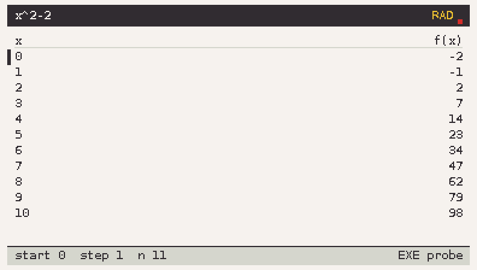 | 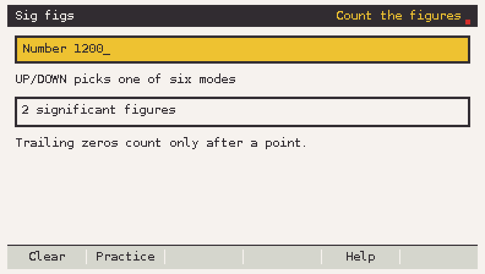 |
| 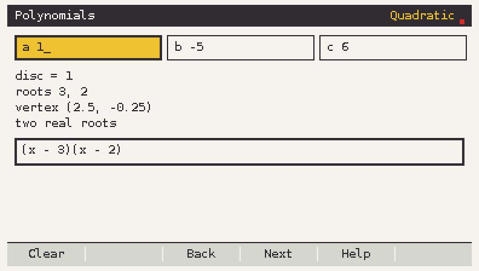 | 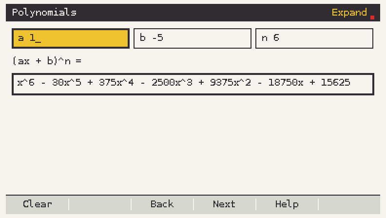 |
| 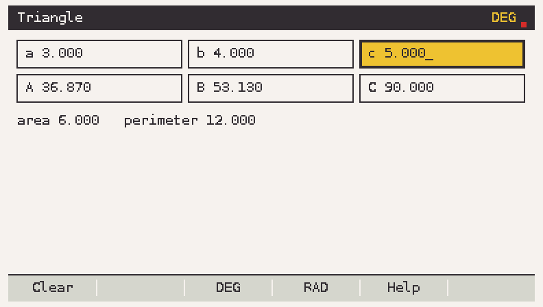 | 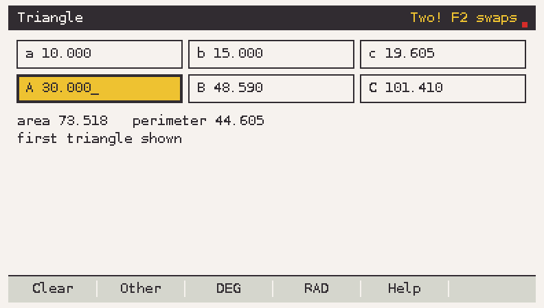 |
| 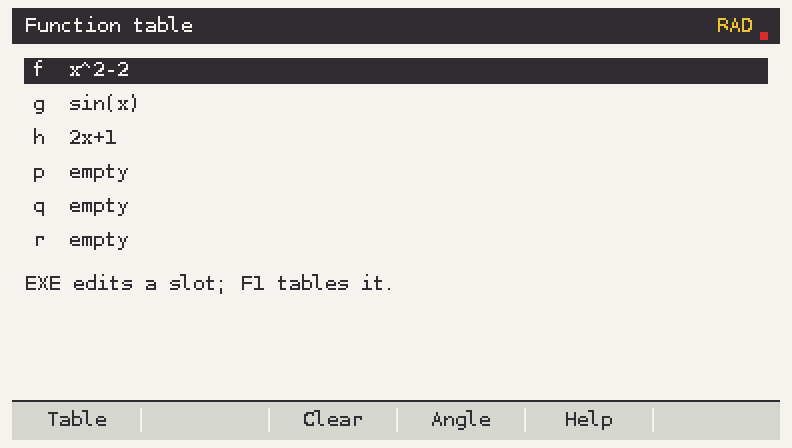 | 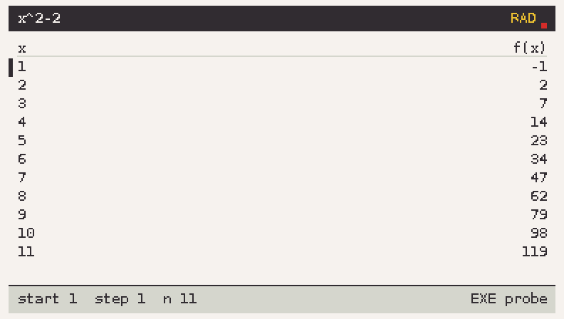 |
| 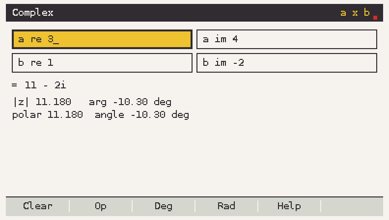 | 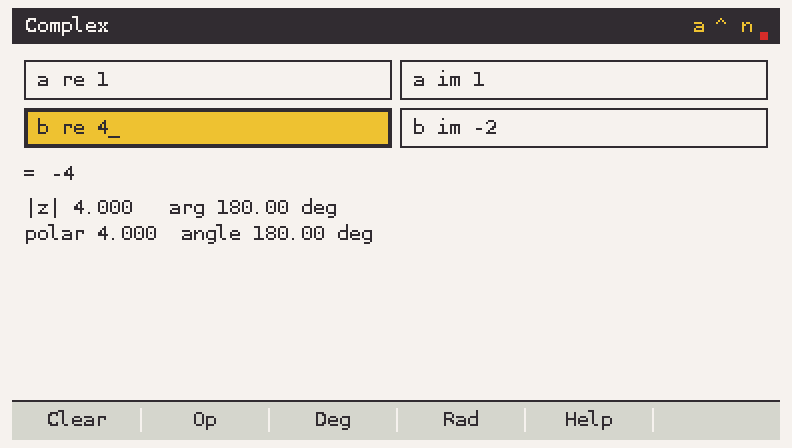 |
| 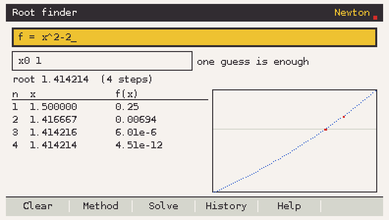 | 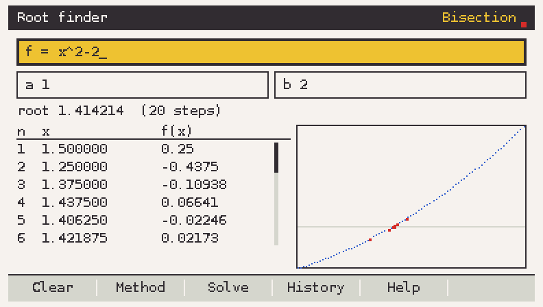 |
| 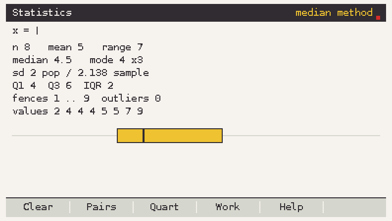 | 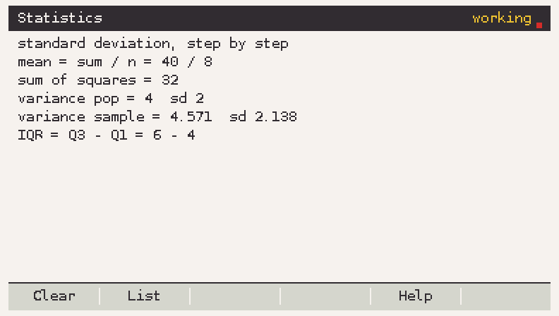 |
| 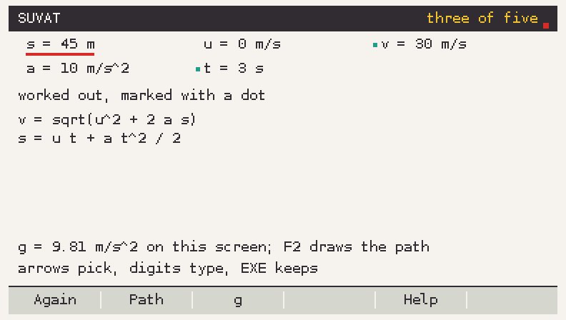 | 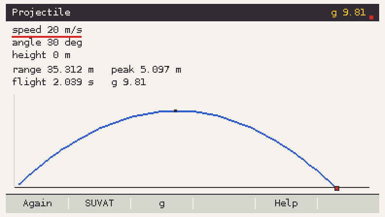 |

Every picture in `docs/images/` is a real frame drawn by the add-in's own code,
rendered on a PC by `make sim` (see [Working on the code](#working-on-the-code)).
No mock-ups.

## The tools

### Pacer
Minutes per mark, checkpoint times, and a live gap line: *"Behind by 1m20s"*.

- Setup: total minutes, total marks, marks per checkpoint.
- Enter 90 minutes and 80 marks, get 1.125 min/mark and eight checkpoints.
- Run: a clock, F1 to log a mark, F2 to pause, F3 to finish. The screen
  redraws four times a second, no faster.
- Done: total time and the final gap.

### Uncertainty
Combines measured values with their errors.

| Operation | Value | Uncertainty |
|---|---|---|
| A + B, A - B | a + b, a - b | da + db |
| A * B, A / B | a * b, a / b | \|r\| * (da/\|a\| + db/\|b\|) |
| A ^ n | a^n | \|r\| * \|n\| * da/\|a\| |
| k * A | k * a | \|k\| * da |

The result is shown as value, absolute uncertainty and percentage: `15.0 +/- 0.3`
with `(2.0 %)`. F1 chains the result into A for the next operation. Rounding
follows the setting: one figure for the uncertainty, or two when its first digit
is 1. Half-up on decimal digits, never on the binary float, so `0.15` rounds to
`0.2` the way a physics teacher expects.

### Cards
A Leitner drill over a plain text deck.

```
What is the unit of impulse? | N s
Ohm's law | V = I R
```

- One card per line, `question | answer`. Blank lines and `#` lines are skipped.
- 500 cards a deck, 120 characters a side; a line that cannot be used is
  reported with its line number and skipped.
- Three boxes: right moves a card up, wrong returns it to box 1. Box 1 is drawn
  every session, box 2 every other session, box 3 every fourth.
- Progress is keyed by a hash of the *question*, so editing an answer keeps the
  box and editing a question resets it.
- Saved once, when a session ends.

### Notes
A viewer for text and a Markdown subset, with search.

- Files from `Bench/notes`, `.md` and `.txt`, up to 32 KiB each.
- Markdown: `#` to `###`, **bold**, *italic*, `code`, fenced code, bullets,
  numbered lists, quotes, rules, links as text, `- [ ]` / `- [x]` checkboxes.
  Anything else is shown as plain text. Style is colour and underline (Phase A),
  so no extra fonts are needed.
- Scroll by line or page, F1 search, F2 next hit, F3 heading list, F4 top.
- Characters the calculator font does not have are drawn as `?` and counted in
  the footer. `tools/md2bench.py` maps the common symbols to ASCII first.

### Function table
The expression engine, with a table and a probe. `src/core/expr.c` is a
shunting-yard parser with a fixed 32-entry operator stack, so no expression can
overflow the calculator's stack, and errors come with the column that failed
(`1/0` is "divide by zero at column 2").

- Operators `+ - * / ^`, unary minus, implicit multiplication (`3x`, `2(x+1)`),
  `x`, `pi`, `e`.
- Functions `sin cos tan asin acos atan sinh cosh tanh exp ln log sqrt abs floor
  ceil`, case insensitive.
- Six slots `f g h p q r`, saved to `Bench/state/exprs.txt` when you leave the
  tool, and only when one changed.
- A table of `x` and `f(x)` with a start, a step from 0.1 to 10 and a row
  count; EXE probes one value; F4 switches degrees and radians, and the mode is
  in the title bar.
- The maths is `src/core/mathfn.c`: sqrt, exp, ln, log10, pow, the
  trigonometric functions and their inverses in plain C, no libm.

### Number theory
Unsigned 64-bit arithmetic, inputs up to 18 digits, no 128-bit integers.

| Function | Result |
|---|---|
| gcd, lcm | Euclid / lcm = a*b/gcd |
| ext gcd | Bezout coefficients, shown with the steps |
| inverse | `a^-1 mod m`, an error when gcd(a, m) != 1 |
| modpow | square and multiply with `mulmod` |
| is prime | deterministic Miller-Rabin for 64 bits |
| factor | trial division then Pollard rho, progress bar, EXIT cancels |
| totient | Euler phi |
| CRT | one pair or a list of congruences |

### Sequences and binomials
Arithmetic and geometric terms, the sum of the first n, the sum to infinity when
`|r| < 1`, and binomials.

`C(n,k)` is computed exactly and the factors are cancelled before they are
multiplied, so `C(52,5)` is right and `C(62,31)` still fits; a coefficient that
would pass 64 bits is refused rather than printed wrong. Row n of Pascal's
triangle is listed underneath.

### Triangle solver
Give any three of the six values, at least one a side, and the rest fills in.
SSS, SAS, ASA and AAS go through the law of cosines and the law of sines; SSA
reports **two** triangles when there are two instead of quietly picking one, and
F2 swaps between them.

The six boxes are `a b c` over `A B C`, so the labels match the sides they are
opposite. F3 is degrees, F4 is radians, and the unit is in the title bar.

### Polynomials
Quadratics and the arithmetic around them, over a small fixed-size polynomial
type (`src/core/poly.c`, degree 8 at most, doubles for coefficients).

| Screen | What it answers |
|---|---|
| Quadratic | discriminant, both roots (real or complex), the vertex, and the factor pair when the roots are whole |
| Expand | `(ax + b)^n` term by term, n up to 8 |
| Roots | a polynomial typed as coefficients: the rational roots, and what is left over |

Roots are typed as `c0..cn`, not as text: the keypad has no letters for `x^2`,
and the ALPHA mapping is one of the things only the device can settle. The
rational root theorem does the searching, so `2x^2 - 3x + 1` finds `1/2` and
`1`, while `x^2 + 1` honestly reports none.

### Root finder
`f(x) = 0`, three ways, and the table that shows the method working:

| Method | Needs | Reaches `x^2 - 2` from |
|---|---|---|
| Bisection | a bracket with a sign change | `[1, 2]` in 20 steps |
| Newton | one guess (slope from a step of 1e-6) | `x0 = 1`: 1.5, 1.416667, 1.414216 |
| Secant | two guesses, no derivative | `1, 2` in 5 steps |

The table lists n, x, f(x) and how far the estimate moved, and a small plot of
the curve marks every iterate in red, so a student can see the error fall rather
than be told that it does. A bracket without a sign change says so instead of
inventing a root, and so does a zero slope. Everything is in radians whatever
the angle setting says, and the title bar says which method is running.

### Complex numbers
`a` and `b`, one operation at a time, and the answer in all three forms at once
so a student can see that they are the same number.

| Shown | For `a = 3 + 4i`, `b = 1 - 2i` |
|---|---|
| rectangular | `a x b` -> `11 - 2i`, `a / b` -> `-1 + 2i` |
| modulus and argument | `|z| 2.236`, `arg 116.57 deg` |
| polar | the same pair as `2.236 angle 116.57 deg` |

`a ^ n` takes n from the real part of `b` and goes up to 64 either way, so
`(1 + i)^4` is `-4` and `(1 + i)^-1` is `0.5 - 0.5i`. Dividing by `0 + 0i` says
`not a number` instead of printing an infinity, and F3/F4 put the argument in
degrees or radians, the unit in the title bar.

### Sig figs
Count them, round them, write them in standard form or with an SI prefix, then
practise. Significant figures are counted on the **text**, not on the value, so
`1200` has 2 and `1200.` has 4 - which is exactly the point students lose marks
on.

| Mode | What it answers |
|---|---|
| Count the figures | `0.004560` -> 4 |
| Round to n figures | `1234.5` to 3 -> `1230` = `1.23 x 10^3` |
| Round to n decimals | half up on the next decimal |
| Standard form | `4.56 x 10^-3`, always with the power |
| SI prefix | `4.56 m`, `45.6 u`, `0.0456 n` - the unit is yours |
| Practice | eight awkward values, typed answer, score |

Rounding is half-up on the decimal digits, never on the binary float, so
`1.2345` to 3 figures is `1.23` and `1.2355` is `1.24`.

### Statistics
Type the values; the summary, the box plot and the fences update as you go.
Both quartile conventions are one key apart, because the IB and the spreadsheet
disagree and the student should see which one they are being marked against.

| Shown | For `2 4 4 4 5 5 7 9` |
|---|---|
| n, mean, range | 8, 5, 7 |
| median, mode | 4.5, 4 (three times) |
| sd | 2.000 population, 2.138 sample |
| Q1, Q3, IQR | 4 / 6 (median method), 5.5 (linear), IQR 2 |
| fences | 1 .. 9, outliers counted |
| box plot | whiskers to the fences, box Q1 to Q3, median line |

F2 turns the list into paired data, taken in x, y order: five points give
`y = 2.2 + 0.6x`, `r = 0.775` and `r^2 = 0.600`. F4 writes the standard
deviation out step by step; F3 swaps the quartile method.

### SUVAT and projectiles
Any three of `s`, `u`, `v`, `a`, `t` fix the other two. The screen fills the
grid as you type and lists the equation behind each value, so the working is on
the screen and not in your head.

| Given | Worked out |
|---|---|
| `s = 45`, `u = 0`, `a = 10` | `v = 30 m/s`, `t = 3 s` |
| `s = 75`, `u = 20`, `a = -2` | `v = 10 m/s`, `t = 5 s` (the other root is 15 s) |
| `u = 20`, `v = 10`, `t = 5` | `a = -2 m/s^2`, `s = 75 m` |

F2 draws the flight path for a launch speed, angle and height: `20 m/s` at `30`
degrees from the ground gives `35.3 m` of range, a `5.10 m` peak and `2.04 s` in
the air. F3 switches `g` between 9.81 and 10.

### Moles and solutions
One mode per calculation a paper asks for, each opening on a worked example so
the shape of the answer is on screen before anything is typed.

| Mode | Answers | Example |
|---|---|---|
| Moles | `n = m / Mr` | 4 g of NaOH, Mr 40 -> 0.1 mol, 6.02e22 particles |
| Concentration | `c = n / V` | 0.1 mol in 0.25 dm3 -> 0.4 mol/dm3, that is 250 cm3 |
| Gas equation | `n = pV / RT` | 100 kPa, 24 dm3, 298 K -> 0.969 mol |
| Dilution | `c2 = c1 V1 / V2` | 20 cm3 of 0.5 into 250 cm3 -> 0.04 mol/dm3 |
| Yield and atom economy | `% = actual / theory` | 3.5 g against 5 g -> 70% |

Volumes are in dm3 because that is what `c = n / V` wants, so 25 cm3 is
`0.025`; the screen says so under each field. `R` is 8.314, for p in kPa and V
in dm3. A zero where a formula divides is refused, not printed as infinity.

### Base and bits
One number in every base, and the same number as a two's complement pattern at
the three widths a paper uses.

| Base 10 | 255 | -1 |
|---|---|---|
| hex | FF | -1 |
| octal | 377 | -1 |
| binary | 11111111 | -1 |
| 8-bit | 1111 1111 = FF | 1111 1111 = FF |
| 16-bit | 0000 0000 1111 1111 = 00FF | 1111 1111 1111 1111 = FFFF |
| 32-bit | ... 0000 1111 1111 = 000000FF | ... 1111 1111 = FFFFFFFF |

F1 switches to the operators: `12 AND 10 = 8`, `12 XOR 10 = 6`, and shifts with
the count in `b`, shown in binary, decimal and hex with the bits set. A shift of
63 or more is refused rather than undefined. F3 changes the entry base (2, 8,
10, 16, 36) or the operator; F2 opens the letter keyboard, because the keypad
has no A-F keys this add-in may count on.

### Lab graph
Type a measured pair and its uncertainty, then look at the picture rather than
the numbers.

| Points (x, y, +-err) | Fit |
|---|---|
| (1, 0.52, 0.1) (2, 0.98, 0.1) (3, 1.51, 0.1) (4, 2.03, 0.1) (5, 2.47, 0.1) | gradient 0.495 +- 0.009, intercept 0.017, r^2 0.999 |

The gradient carries its standard error, worked out from the residuals:
`s = sqrt(sum of residuals^2 / (n - 2))`, `dm = s / sqrt(Sxx)`. Fewer than
three points leave nothing to measure the error against, so it is left off
rather than faked. The axes hold the whole error bar, not just the centre, so a
measurement can never run off the top of the graph.

### Study log
A plain text file, `Bench/study/log.txt`, one line a session:

```
2026-10-31 25 pacer
2026-11-01 40 cards
```

The screen reads it and shows the totals, the days logged and the longest run
of consecutive days. F1 adds an entry: type the minutes, UP/DOWN picks the tool,
EXE saves. A line it cannot read is skipped and counted, never added up wrongly.

Bench cannot read the calendar - gint's date fields were never checked on the
hardware, see `docs/spike.md` - so a new entry takes the day after the newest
one in the log, and UP/DOWN on the day moves it. The file is written once, when
you leave the screen, never in a loop.

### Prime factors
`360 = 2^3 x 3^2 x 5`, then the four numbers that follow from it:

| | 360 | 1024 |
|---|---|---|
| divisors | 24 | 11 |
| their sum | 1170 | 2047 |
| totient | 96 | 512 |
| square-free part | 30 | 2 |
| perfect square | no | yes |

Up to 18 digits, with Miller-Rabin and Pollard's rho behind it. F2 halves the
number and factors again. The factorisation text is written with `^` because the
calculator's default font has no superscript digits, and inventing a glyph is
worse than an honest `2^3`.

### Percentages
Four questions on one screen, with the working under the answer:

| question | example | answer |
|---|---|---|
| change | from 40 to 46 | 15.00%, a rise |
| add or take | 40 with 15% added | 46.00 |
| reverse | 34 after 15% off | 40.00, as `34 / (1 - 15/100)` |
| compound | 500 at 4.5% for 7 years | 680.43 |

The reverse case prints the division, because "add 15% of 34 back on" is the
mistake the screen exists to catch. Three questions have no answer - a change
measured from zero, a 100% discount, a year count outside 0-200 - and the page
says which rather than showing a 0.

### Formula book
The IB AA HL, Physics 2025 and Chemistry 2025 booklets as plain text in
`Bench/formulas/`, one `.txt` per booklet. UP/DOWN scrolls a line, LEFT/RIGHT
jumps a topic, `#`/`##`/`###` are the three heading levels. Any `.txt` in that
folder appears in the list, so a booklet you write yourself needs no rebuild.

**The three shipped booklets have not been proofread against the official PDFs**
- the PDFs print formulae as images, so every line was typed. Each booklet says
so on its first line, and `docs/samples/formulas/needs-human-proofreading/`
lists what to check first.

### Pi game
Type the next digits of pi; every digit right moves you along, the first wrong
one costs a life, and F2 gives a digit away at the cost of one. Three lives.
200 digits, checked against a spigot computed from the algorithm rather than
copied from the table. Nothing is written to the card, so the best score lives
as long as the session.

## Keys

| Key | Where | What |
|---|---|---|
| Arrows | everywhere | move, scroll, change a value |
| EXE | everywhere | confirm, reveal a card, run |
| EXIT | everywhere | one step back |
| MENU | everywhere | leave the add-in for the calculator's main menu |
| F1 | Pacer run | log a mark |
| F1 / F2 | Cards, answer shown | right / wrong |
| F1 / F2 | Uncertainty result | chain the result / edit A |
| F1 / F2 | Notes | search / next hit |
| F1 | Number theory | run the function |
| F3 / F4 | Notes | heading list / jump to the top |
| F1..F4 | home | the four categories: Study, Math, Science, Tools |
| F5 | everywhere | help for this screen (on the home screen, for the selected tile) |
| F1 / F2 | Sig figs | clear the number / practice |
| F3 / F4 | Sequences | previous / next screen |
| F1 / F2 | Statistics | clear the list / single and pairs |
| F3 / F4 | Moles | previous / next calculation |
| UP / DOWN | Moles | pick a field |
| F1 | Moles | the mode's worked example again |
| F1 | Base and bits | convert / operators |
| F2 | Base and bits | the letter keyboard for A-F |
| F3 | Base and bits | entry base / the operator |
| F4 | Base and bits | swap a and b |
| EXE | Lab graph | add the point |
| F2 | Lab graph | the graph |
| F3 | Lab graph | the example data |
| F1 | Study log | add a session |
| F2 | Study log | delete the last entry |
| LEFT / RIGHT | Study log | minutes / tool / day |
| F2 | Cards, on a deck | mixed order inside each box |
| F3 / F4 | Statistics | quartile method / the working |
| F2 | SUVAT | the flight path |
| F3 | SUVAT | g = 9.81 or 10 |
| LEFT / RIGHT | SUVAT | pick a quantity |
| F3 / F4 | Triangle | degrees / radians (re-solves) |
| F2 | Triangle | the other triangle, when SSA has two |
| F3 / F4 | Polynomials | previous / next screen |
| F2 | Complex numbers | the operation: +, -, x, /, ^ |
| F3 / F4 | Complex numbers | argument in degrees / radians |
| F2 / F3 | Root finder | next method / solve |
| F4 | Root finder | the last eight answers |
| EXE | Root finder | edit f, or solve from a number field |
| UP/DOWN | Root finder | move between fields, then scroll the table |
| F2 | Polynomials, roots | one more coefficient |
| UP/DOWN | Sig figs | pick one of the six modes |
| F4 / F3 | Sig figs | next / previous mode |
| UP/DOWN | Settings | pick a row |
| LEFT/RIGHT | Settings | change the selected row |
| F3 | Settings | the hardware report: mark what the device does, F2 writes `state/hwreport.txt` |
| EXE | Home screen | open the selected tile |
| F5 | Home screen | explain the selected tile; the hint line goes away |
| LEFT/RIGHT | Sig figs | the n of the rounding modes |
| F6 | home | About |
| F1 / F2 / F3 / F4 | Function table | table / row count / clear slot / degrees-radians |
| digits, `.`, `-` | number fields | type a value, DEL removes |

Text entry does not use the ALPHA key. The search field opens a small on-screen
keyboard (arrows to move, EXE to pick), because the ALPHA letter mapping is one
of the things only the calculator can confirm.

## Files on the calculator

Everything lives in one folder. The add-in creates the subfolders on first run.

```
fls0/                       <- storage memory: the drive Windows shows
  Bench/
    notes/*.md, *.txt       your notes        (Notes)
    cards/*.txt             decks             (Cards)
    study/log.txt           study log         (Study log, written on exit)
    formulas/*.txt          booklets          (Formula book)
    state/cards.sav         Leitner boxes     (Cards, written at session end)
    state/settings.cfg      settings          (Settings, written on change)
    state/exprs.txt         f, g, h, p, q, r  (Function table, written on exit)
    state/hwreport.txt      device report     (Settings F3, written on F2)
```

The add-in reads and writes nothing outside `fls0/Bench/`.

### The two folders that look right and are not

`@MainMem` is **main memory**, mirrored inside the drive. The calculator takes
what is in it and **moves anything it will not keep to `SAVE-F`** when the cable
is pulled (`fx-CG 50` manual, 13-6: contents past three levels, and anything it
does not recognise). A `Bench` folder copied into `@MainMem` therefore ends up in
`SAVE-F/Bench`, and Bench cannot read it there.

`SAVE-F` is that bin. Files in it are not lost, they are just not where the
add-in looks.

So: the `.g3a`, and the `Bench` folder with your notes in it, both go in the
**drive root**, next to `@MainMem` — never inside it. If the Notes screen says
"Notes are in SAVE-F", that is exactly what happened, and moving
`SAVE-F/Bench/notes` to `Bench/notes` fixes it.

Storage rules the code follows, to spare the flash: write a file once and rename
it into place, never write inside a loop or on a timer, save cards only at the
end of a session, save settings only when a value changes.

`state/settings.cfg` is plain text and safe to edit:

```
# Bench settings v1
uncert_sig 1          # 1 figure, or 2 when the first digit is 1
pacer_checkpoint 10   # marks between checkpoints, 1..200
angle_unit 0          # 0 = degrees, 1 = radians; the unit Triangle opens in
tour_done 0           # 1 once the first-run line on the home screen is gone
notes_wrap 0          # 0 = fit the screen, else 50..150 percent
startup_cat 0         # 0..3: the category the home screen opens on
show_hint 1           # 1 to show the first-run line at all
pacer_warn 5          # minutes left when the clock turns red; 0 = never
```

## Starter pack content

Something to look at before you have written a single note: three Markdown
notes, three decks of cards, three formula booklets and eighteen lines of study
log.

**It comes with the add-in.** A `.g3a` is one file, so the ten files are
compiled into it and written to the card on the first run - install the add-in,
open Notes / Cards / Study log / Formula book, and they are already there.
Only files that are **not there yet** are written, so nothing you wrote is ever
overwritten, and a card that is full still gets a working add-in - just without
the starter pack.

**Or take it as a zip.** `Bench-starterpack-1.2.8.zip` is the same ten files on
their own, laid out as `Bench/notes`, `Bench/cards`, `Bench/study` and
`Bench/formulas`: extract it onto `D:\` in USB Flash mode. That is for a full
card, a second card, or editing the notes on a PC before they reach the
calculator.

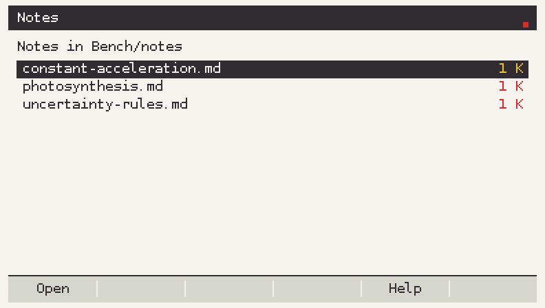

The sources are `starterpack/notes`, `starterpack/cards`, `starterpack/study`
and `docs/samples/formulas`. Both the embedded copy and the zip are generated
from them (`make starterpack-gen`, `make starterpack-zip`) and checked against
them in CI (`make starterpack-check`, `make starterpack-zip-check`), so the
three cannot drift apart.

**The text needs human proofreading.** It is written for the starter pack, in
my own words, and has not been checked by a teacher; treat it as revision notes
and check anything before you rely on it in an exam.

## Install

`Bench-1.2.8.g3a` is in five places. Take whichever works from where you are:

| Where | How |
|---|---|
| This site | <https://bench-gdc.vercel.app/Bench-1.2.8.g3a> - one click, no account |
| Release | [releases page](../../releases) - the same bytes, attached by CI, with `Bench-starterpack-1.2.8.zip` beside it |
| Newest build | release [`auto`](../../releases/tag/auto) - rebuilt from `main` every few days, replaces itself |
| `dist/` in the repo | [`dist/Bench-1.2.8.g3a`](dist/Bench-1.2.8.g3a), with [`dist/BUILD.txt`](dist/BUILD.txt) naming the commit, size and SHA-256; the starter pack zip sits beside it |
| `builds` branch | `git fetch origin builds && git show origin/builds:Bench-1.2.8.g3a > Bench-1.2.8.g3a` - plain git, for when release downloads are blocked |

The copy in `dist/` is the one to use when GitHub's release assets and artifacts
are unreachable: it is a normal file in a normal clone.

1. Download the file.
2. Connect the calculator in **USB Flash** mode. One drive appears: that is
   storage memory, and its root is where things go.
3. Copy `Bench-1.2.8.g3a` there — **beside** `@MainMem`, never inside it.
4. Open Bench once. It creates `Bench/notes`, `Bench/cards`, `Bench/study`,
   `Bench/formulas` and `Bench/state`, and fills the first four with the starter
   pack, so there is nothing to copy for a first look. Your own notes go in the
   same folders; only missing files are written, so nothing of yours is
   replaced. If you prefer the starter pack as files, extract
   `Bench-starterpack-1.2.8.zip` onto the same root instead — it has the same
   ten files in the same folders.
5. Eject or unmount properly, then press **MENU** on the calculator; Bench
   appears as a new add-in.

Exam Mode disables add-ins entirely. Bench never reads, changes or works around
Exam Mode; if the calculator is in Exam Mode, the add-in simply does not run.

## Working on the code

Two builds, on purpose.

**On a PC, no calculator and no toolchain needed:**

```sh
make test     # the core modules: 40 programs, no gint
make py-test  # every Python tool: the md2bench converter, the version bump, the
              # CodeRabbit configuration (87 tests)
make sim      # the whole add-in compiled against a small gint stand-in
make shots    # render every screen into docs/images
make starterpack-gen # rebuild the starter pack that ships inside the add-in
make starterpack-zip # rebuild dist/Bench-starterpack-<version>.zip
```

The starter pack is generated, not written twice: `tools/gen_starterpack.py` turns `starterpack/` and
`docs/samples/formulas/` into `src/apps/starter_data.c` and
`tools/make_starterpack_zip.py` packs the same files into the zip. Edit the sources;
`make starterpack-check` and `make starterpack-zip-check` fail if the generated copies are
stale.

`make sim` builds `build/sim/bench`, which runs the real `src/apps` code against
`tools/sim/`, a stand-in for gint that draws into a 396x224 framebuffer and
writes PPM frames. It reads a key script:

```sh
BENCH_FS=/tmp/bench-fs BENCH_KEYS=tools/sim/tour/04_pacer_run.txt \
  BENCH_SHOT=/tmp/run.ppm build/sim/bench
```

**For the calculator:**

```sh
fxsdk build-cg          # needs the fxSDK + SuperH toolchain, see docs/toolchain.md
```

The version comes from `version.txt`, so the `.g3a` name, the About screen and
the tag always agree. **Every change bumps it** - `make bump-patch` for a fix,
`make bump-minor` for a feature - and `make version-check` fails if the six places
that quote it have drifted apart. See [docs/VERSIONING.md](docs/VERSIONING.md).

### Layout

```
src/core/       plain C11, no gint, every function tested on a PC
src/platform/   the only place that calls gint: screen, input, store, mem
src/ui/         theme, widgets, shapes, number formatting
src/apps/       one file per tool, init/draw/key
src/main.c      the router
tests/          native tests, one program per core module
tools/sim/      host preview: a gint stand-in, key scripts, screenshot tour
tools/brand/    the icons and the wordmark
tools/md2bench.py  clean a Markdown file before copying it over
spike/          the M1 diagnostic add-in, and spike.diff: the same thing as one patch
dist/           the built .g3a, committed, with BUILD.txt naming the commit
docs/           plan, task specs, toolchain notes, spike answers, status
site/           the landing page: React + Vite + Tailwind (see site/README.md)
```

The split exists so maths and parsing bugs surface on a PC in seconds; only
drawing and input need the calculator.

### Review

Pull requests get a CodeRabbit review written against
[`.coderabbit.yaml`](.coderabbit.yaml), which is in the repository rather than in
a dashboard: `src/core` may not include gint or libm, a screen may only use the
nine palette colours, a regenerated table is not a code change, and no bot
approves a build nobody ran on hardware. `make coderabbit-check` reads it with a
parser of its own (no new dependency) and fails on a misspelt key or a rule for a
directory that was renamed. Installing the GitHub App is the one manual step -
see [docs/CODERABBIT.md](docs/CODERABBIT.md).

## Status

Everything in this repository is code that builds and tests on a PC. **No
`.g3a` was produced by the agent that wrote it**: the sandbox had no SuperH
compiler and could not reach `git.planet-casio.com`. The workflow in
`.github/workflows/build.yml` installs fxSDK and gint and builds the file on a
GitHub runner; `docs/STATUS.md` lists the ten questions only a calculator can
answer (file API behaviour, float printing, font coverage, redraw time, heap).

The newest `.g3a`, `Bench-1.2.8.g3a`, is built by CI from the `v1.2.8` tag and
carries the starter pack inside it: the notes, decks, study log and formula
booklets are written to the card on the first run, and the same ten files are
also on the release as `Bench-starterpack-1.2.8.zip`. Everything in `main`
builds and passes its tests. 1.0.0 and 1.1.0 have been run on a calculator, the second of them through
every tool it shipped with; 1.2.x has not, and each changelog entry says so.

## Releasing

`RELEASING.md` has the steps. Short version: the version is already bumped by
the change that earned it (`docs/VERSIONING.md`), so a release is the changelog
section renamed from "unreleased" to a date plus a tag `vX.Y.Z`; push the tag; the workflow runs the tests, builds `Bench-X.Y.Z.g3a` with the
real fxSDK and attaches it to the release.

There is a second, rolling release, tagged `auto`. Once a day at 03:30 UTC
`auto-build.yml` asks whether the last automatic build is at least three days
old; if it is, it builds the tip of `main` and **replaces** that release - same
tag, same file name - so the releases page never grows a pile of nightly
builds. It also keeps the 1.5 GB toolchain cache alive (GitHub evicts a cache
after seven days, and rebuilding it takes about fifty minutes) and proves that
`main` still compiles. To run one by hand: Actions -> Automatic build -> Run
workflow.

The `bench-spike` artifact in CI is the M1 diagnostic add-in, not Bench: it
answers the hardware questions in `docs/spike.md` and has never been a release
asset. It is also committed as `dist/Bench-spike-0.0.2.g3a` (with a `SPIKE.txt`
manifest) and downloadable from the site's downloads page, under its own
"diagnostic add-in" heading, together with `spike.diff`.

## Credits

- [gint](https://gitea.planet-casio.com/Lephenixnoir/gint) and the
  [fxSDK](https://gitea.planet-casio.com/Lephenixnoir/fxsdk) by Lephenixnoir and
  contributors.
- The Bauhaus palette from the plan: paper `#f4f3ee`, ink `#2f2d2e`, red
  `#d92d27`.

Written with an AI agent (Arena) under `AGENTS.md`, which fixes the rules the
code follows: core without gint, tests for every function, no OS, bootloader or
Exam Mode code.
